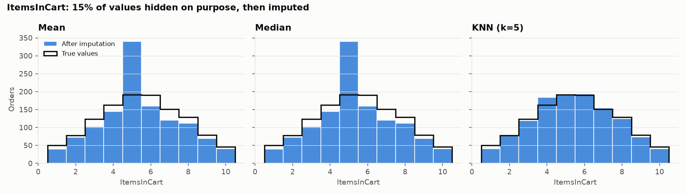

# Advanced EDA & Feature Engineering — E-commerce Orders

**DecodeLabs Data Science Internship · Project 1 (2026)**

A tested, reproducible Python pipeline that turns the raw e-commerce orders dataset
(1,200 orders, Excel) into two clean outputs: an **analysis table** for business reporting
and a fully numeric **model-ready table** for machine learning. It follows the training kit's
**Input → Process → Output** design.

📓 **Start here:** [`notebooks/01_eda_feature_engineering.ipynb`](notebooks/01_eda_feature_engineering.ipynb) —
every step with its heading, explanation and output.

---

## Requirements covered

| Project requirement | How it is done |
|---|---|
| Handle missing data with statistical imputation (Mean / Median / KNN) | Missing-data decision matrix implemented (<5% drop · 5–20% median · >20% KNN). `CouponCode` (25.75% blank) is a **structural** gap — blank means "no coupon" — so it is labelled `NONE` with a `HasCoupon` flag instead of being guessed. Mean, Median and KNN are compared on purposely hidden values of `ItemsInCart`. |
| Identify and neutralise outliers (Z-score / IQR) | Both rules on all numeric columns. 8 `TotalPrice` values exceed the IQR fence (Z-score finds none) and are capped with `numpy.clip`; no rows deleted. |
| Engineer at least 3 new predictive features | 7 engineered: `OrderMonth`, `OrderDayOfWeek`, `IsWeekend`, `DaysSinceStart`, `HasCoupon`, `OtherItemsInCart`, `QuantityShareOfCart` (6 kept after collinearity removal). |
| Pandas, NumPy, statistical analysis | Fully vectorised — no row-by-row loops. |

Also from the training kit (Phases 2–3): one-hot encoding with a reference category,
collinearity removal (|r| > 0.80), Pandera data contracts on input and output,
a `fit_transform()` / `transform()` design that prevents training-serving skew,
and Parquet output.

## Results

| | Rows | Columns | Missing values |
|---|---|---|---|
| Raw data | 1,200 | 14 | 309 |
| Analysis table (`orders_clean.csv`) | 1,200 | 18 | 0 |
| Model table (`orders_model_ready.csv`) | 1,200 | 31 (OrderID + 30 features) | 0 |

**Data quality:** 0 duplicate orders; every row satisfies `ItemsInCart ≥ Quantity` and
`TotalPrice = Quantity × UnitPrice`.

**Missing values:** only `CouponCode` (309 blanks). A chi-square test shows no significant link
between blank coupons and order status, product, payment method or referral source (all p > 0.05).

**Imputation experiment** — 15% of `ItemsInCart` hidden at random, averaged over 20 repeats:

| Method | MAE on hidden values | RMSE | Std after (true 2.282) | KS vs true |
|---|---|---|---|---|
| Mean | 1.925 | 2.309 | 2.099 | 0.080 |
| Median | 1.950 | 2.379 | 2.106 | 0.079 |
| **KNN (k = 5)** | **1.640** | **1.914** | **2.197** | **0.025** |

KNN has 14.8% lower error than the mean and keeps the distribution's shape;
Mean/Median pile every gap onto one value.



**Outliers:** `Quantity`, `UnitPrice` and `ItemsInCart` have none. `TotalPrice` has 8 by the IQR rule —
all genuine orders of 5 units priced above 666. They are kept in the analysis table (real revenue) and
capped at 3,330.41 in the model table (largest change 3.6%).

**Collinearity removed:** `CouponCode_NONE` (exact mirror of `HasCoupon`, r = 1.00) and
`QuantityShareOfCart` (r = 0.84 with `OtherItemsInCart`). Highest remaining pair: r = 0.795.

The full auto-generated report is in [`reports/summary.md`](reports/summary.md).

## Project structure

```
├── data/
│   ├── raw/Dataset_for_Data_Analytics.xlsx   # course dataset, never modified
│   └── processed/                            # outputs (generated)
├── feature_pipeline/                         # all project logic (Python package)
│   ├── config.py          # paths, column roles, thresholds
│   ├── schema.py          # Pandera input / output contracts
│   ├── missing.py         # decision matrix + imputation experiment
│   ├── outliers.py        # IQR / Z-score detection, numpy.clip capping
│   ├── features.py        # engineered features
│   ├── collinearity.py    # correlation-based feature removal
│   ├── pipeline.py        # FeaturePipeline: fit_transform() / transform()
│   └── report.py          # figures + reports/summary.md
├── notebooks/01_eda_feature_engineering.ipynb   # step-by-step walkthrough with outputs
├── reports/               # summary.md, CSV tables, figures (generated)
├── artifacts/             # pipeline_params.json — every learned value (generated)
├── tests/test_pipeline.py # 25 automated checks
├── .github/workflows/     # GitHub Actions: pipeline + tests + notebook on every push
├── main.py                # one-command run
└── requirements.txt
```

Each folder has its own `README.md` describing its files.

## How to run

```bash
git clone https://github.com/nadiagul01/ecommerce-eda-feature-engineering.git
cd ecommerce-eda-feature-engineering

python -m venv .venv
# Windows:      .venv\Scripts\activate
# macOS/Linux:  source .venv/bin/activate

pip install -r requirements.txt
python main.py     # builds data/processed, artifacts and reports
pytest             # runs the 25 checks
```

## Design decisions and limitations

- **No target column.** The dataset does not define what a model should predict, so the predictive
  value of the engineered features cannot be measured yet; they are chosen on domain grounds.
  For the same reason, collinearity removal drops the feature with the higher average correlation
  to all others instead of the one less related to a target.
- **Fitted on all rows.** No model is trained here. When one is added, call `fit_transform()` on the
  training split only and `transform()` on the test split to avoid data leakage.
- **Capping changes real values.** The 8 capped totals are genuine; capping is applied only to the
  model table, as the project requires outlier neutralisation.
- **Likely practice data.** Near-uniform distributions and a single street name (`Main St`) suggest
  the dataset is synthetic. The methods are the same as for real data.
- **Feature store.** The training kit describes Feast for production serving; that is outside this
  project's scope. The Parquet output and stored parameters are the offline equivalent.

## Tech stack

Python · pandas · NumPy · SciPy · scikit-learn · Pandera · Matplotlib · openpyxl · PyArrow ·
Jupyter · pytest · GitHub Actions
